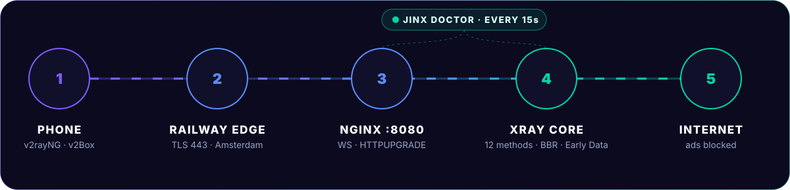
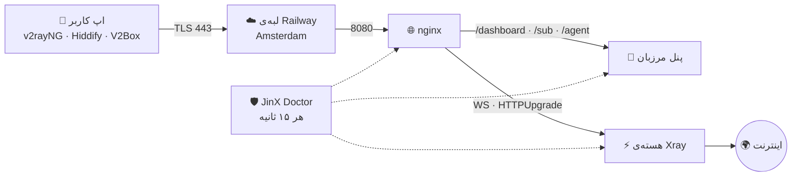
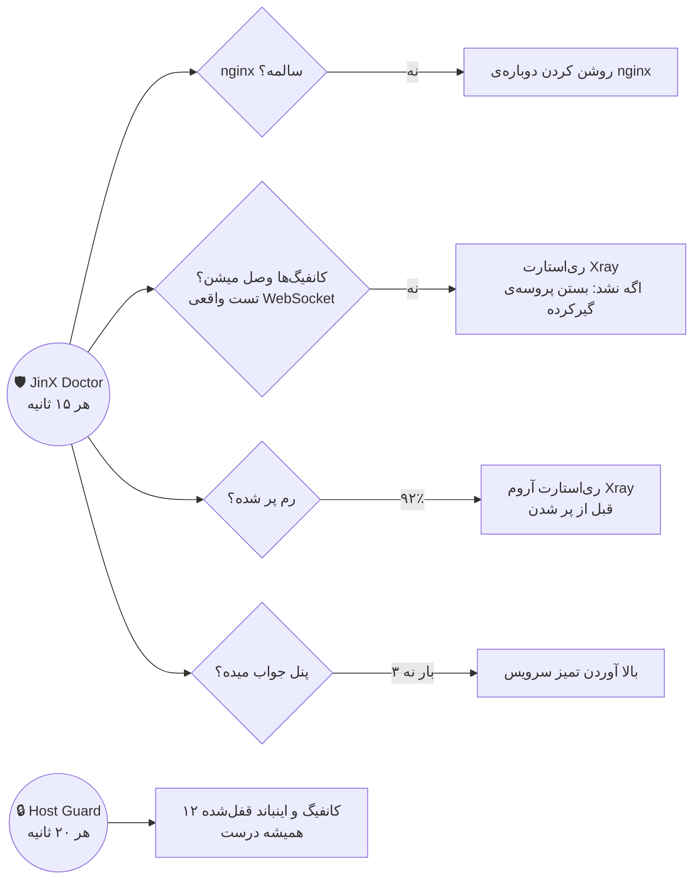

<div align="center">



**فارسی** | [English](README.en.md) | [Русский](README.ru_RU.md) | [中文](README.zh_CN.md)

<br/>


<br/><br/>

# ⚡ جینکس | 𝙎𝙪𝙥𝙚𝙧 𝗝𝗶𝗻𝗫

### پنل مرزبان روی Railway · رایگان · یک‌کلیکی · بدون سرور

**۵ دقیقه** نصب، **۱۲ کانفیگ** آماده برای همه‌ی اپراتورها، **پنل نمایندگی**، صفحه‌ی ساب **JINX PASS** و **ربات‌های نگهبان** ۲۴ ساعته.<br/>
بدون VPS، بدون خرید دامنه، بدون سرتیفیکیت، بدون حتی یک خط ترمینال.

<br/>

<a href="https://t.me/Super_Jinx"></a>
<a href="https://github.com/x4gpanell"></a>


<br/><br/>


</div>

<div dir="rtl">

> [!IMPORTANT]
> **تازه‌های نسخه‌ی ۱۲**
> - کانفیگ‌ها به روش پایدار پاسارگاد: لینک ساده برای همه‌ی اپ‌ها، `ed=2560`، `alpn=http/1.1`
> - **هر ۱۲ کانفیگ واقعاً متفاوت**، با همون اسم‌های همیشگی و بدون اسم تکراری
> - سازگاری کامل با **Hiddify، sing-box و Clash Meta** (حذف Mux و اثرانگشت ناسازگار)
> - تست کانفیگ Xray **قبل از** روشن شدن هسته: هیچ‌وقت هسته به‌خاطر یک تنظیم خاموش نمی‌مونه
> - ربات **رم**، پشتیبان ری‌استارت Xray و صفحه‌ی وضعیت زنده‌ی `/jx-status`
> - صفحه‌ی ساب: نسخه‌ی کامپیوتر از ۹۰۰ پیکسل، دکمه‌های بدون گیر، رنگ‌های خواناتر در تم روشن
> - پنل نمایندگی بدون خطای صفحه، دکمه‌ی **حمایت مالی** که همیشه سر جاش می‌مونه

<br/>

## 📑 فهرست

<table>
<tr>
<td>

- [🌟 چرا سوپر جینکس؟](#why)
- [🖼 تصاویر](#shots)
- [🚀 نصب در ۷ قدم](#install)
- [🔐 اولین ورود](#login)
- [🧭 معماری](#arch)
- [🛰 ۱۲ کانفیگ](#configs)

</td>
<td>

- [📶 اپراتورها و سرعت](#speed)
- [📱 اتصال با اپ‌ها](#apps)
- [🤝 پنل نمایندگی](#reseller)
- [💳 صفحه‌ی ساب JINX PASS](#sub)
- [🛡 ربات‌های نگهبان](#guard)
- [🔒 امنیت](#security)

</td>
<td>

- [🌍 لوکیشن‌ها](#regions)
- [🧩 مسیرهای اختیاری](#extra)
- [⚙️ متغیرها](#vars)
- [🔄 آپدیت](#update)
- [🩺 عیب‌یابی و سوال‌ها](#faq)
- [📂 ساختار پروژه](#files)

</td>
</tr>
</table>

<p align="center"></p>

<a name="why"></a>

## 🌟 چرا سوپر جینکس؟


| | پنل معمولی روی سرور | **⚡ سوپر جینکس** |
|---|:---:|:---:|
| خرید سرور و دامنه | لازمه | **لازم نیست** |
| نصب با ترمینال | لازمه | **لازم نیست** |
| سرتیفیکیت TLS | دستی، هر ۳ ماه تمدید | **خودکار، هیچ‌وقت منقضی نمیشه** |
| ساخت اینباند و هاست | دستی | **۱۲ کانفیگ آماده** |
| کانفیگ مخصوص اپراتورها | ندارد | **۷ اثرانگشت + ۲ نوع فرگمنت** |
| پنل نمایندگی | ندارد | **ویزارد، پکیج، محدودیت سمت سرور** |
| صفحه‌ی ساب اختصاصی | ساده | **JINX PASS، کامپیوتر و موبایل** |
| تعمیر خودکار بعد از خرابی | ندارد | **ربات‌های نگهبان، چک هر ۱۵ ثانیه** |
| بکاپ | دستی | **روزانه، ۷ نسخه‌ی آخر** |
| هزینه | ماهانه | **رایگان** |

<p align="center"></p>

<a name="shots"></a>

## 🖼 تصاویر

<table>
<tr>
<td width="70%"></td>
<td width="30%"></td>
</tr>
<tr>
<td align="center"><sub>JINX PASS · کامپیوتر</sub></td>
<td align="center"><sub>JINX PASS · موبایل</sub></td>
</tr>
<tr>
<td></td>
<td></td>
</tr>
<tr>
<td align="center"><sub>حمایت مالی · کامپیوتر</sub></td>
<td align="center"><sub>حمایت مالی · موبایل</sub></td>
</tr>
</table>

<p align="center"></p>

<a name="install"></a>

## 🚀 نصب در ۷ قدم



> [!TIP]
> کل نصب حدود **۵ دقیقه** طول می‌کشه. فقط یه اکانت GitHub و یه اکانت Railway لازم داری.

| قدم | کار | نکته |
|:--:|---|---|
| **۱** | بالای همین صفحه **Star** ⭐ و بعد **Fork** رو بزن | اسم ریپو هر چی خواستی |
| **۲** | توی [Railway](https://railway.com) بزن `New Project` ← `Deploy from GitHub repo` | ریپوی Fork شده‌ی خودت رو انتخاب کن |
| **۳** | `Settings` ← `Deploy` ← `Regions` ← **EU West (Amsterdam)** | کمترین پینگ از ایران |
| **۴** | روی سرویس راست‌کلیک (روی گوشی: نگه دار) ← `Attach Volume` با مسیر **`/var/lib/marzban`** | بدون Volume با هر Redeploy کاربرها پاک میشن |
| **۵** | `Settings` ← `Networking` ← `Generate Domain` با پورت **`8080`** | یه آدرس `xxxx.up.railway.app` می‌گیری |
| **۶** | مطمئن شو **Serverless / App Sleeping خاموشه** | وگرنه کانفیگ‌ها بعد از مدتی قطع میشن |
| **۷** | از تب `Deployments` یه **Redeploy** بزن | توی لاگ `[lock] xray test: config OK` یعنی همه‌چی آماده‌ست |

<details>
<summary><b>👀 توی لاگ دیپلوی چی باید ببینم؟</b></summary>

<br/>

```text
=== ⚡ Super JinX | Marzban on Railway ===
[lock] TCP Fast Open off
[lock] xray test: config OK
[lock] xray 25.x | config ready: 5 inbounds (...)
[start] region: europe-west4-... (Amsterdam = best for Iran)
[guard] region 🇳🇱 Amsterdam | 12 direct methods | ...
[doctor] online, watching nginx / panel / tunnel / 5 inbounds
```

اگه خط `xray test` هشدار داد، همون پایینش نوشته کدوم قابلیت خودکار خاموش شد و بقیه‌ی کانفیگ‌ها مثل قبل کار می‌کنن.

</details>

<p align="center"></p>

<a name="login"></a>

## 🔐 اولین ورود

<div align="center">

| آدرس پنل | نام کاربری | رمز |
|:--:|:--:|:--:|
| `https://YOUR-DOMAIN.up.railway.app/dashboard/` | `admin` | `admin` |

</div>

> [!WARNING]
> `admin / admin` فقط برای **اولین ورود**ـه. همون اول از منوی پنل گزینه‌ی **«تغییر نام کاربری و رمز عبور»** رو بزن. تغییر همون لحظه اعمال میشه و با Redeploy هم برنمی‌گرده.

<p align="center"></p>

<a name="arch"></a>

## 🧭 معماری





Railway خودش روی پورت **443** TLS می‌زنه و همه‌چی رو به nginx روی پورت **8080** می‌فرسته. nginx پنل، صفحه‌ی ساب، پنل نماینده‌ها و همه‌ی کانفیگ‌های Xray رو از همین یه پورت پخش می‌کنه. هیچ سرتیفیکیتی لازم نیست و هیچ‌وقت هم منقضی نمیشه.

<p align="center"></p>

<a name="configs"></a>

## 🛰 ۱۲ کانفیگ آماده



اسم همه‌ی کانفیگ‌ها با **جینکس | 𝗝𝗶𝗻𝗫** شروع میشه و بعدش اسم روش و پروتکل میاد. هر ۱۲ تا **واقعاً با هم فرق دارن**: هر کدوم ترکیب خودش از پروتکل، انتقال، اثرانگشت TLS و فرگمنت رو داره، پس هر اپراتوری بالاخره یکی رو برنده می‌کنه.

| # | کانفیگ | پروتکل · انتقال | اثرانگشت | فرگمنت | کاربرد |
|:--:|---|---|:--:|:--:|---|
| 01 | 🇳🇱 **Amsterdam Rocket** | VLESS · WS (JinX Core) | ios | — | سرعت کامل، اسمش با لوکیشن عوض میشه |
| 02 | 👻 **Ghost Anti-Filter** | VLESS · WS (JinX Core) | chrome | قوی | وقتی SNI فیلتر شده |
| 03 | 💫 **Hyper Drive** | VLESS · WS | firefox | — | سبک و سریع |
| 04 | 🌪 **Swift Shield** | VLESS · WS | chrome | سبک | تقریباً بدون افت سرعت |
| 05 | 🌀 **Vortex** | VMess · WS | safari | — | سازگار با اپ‌های قدیمی |
| 06 | 🔱 **Trident** | Trojan · WS | edge | — | پایدار |
| 07 | 🥷 **Ninja Stealth** | Trojan · WS | random | قوی | سخت‌ترین شبکه‌ها |
| 08 | ⚡ **Lightning** | VLESS · HTTPUpgrade | chrome | — | سبک‌ترین انتقال، سرعت کامل |
| 09 | 🌠 **Meteor** | VLESS · HTTPUpgrade | ios | سبک | مناسب آیفون |
| 10 | 🛸 **Warp Speed** | VLESS · XHTTP (packet-up) | chrome | — | درخواست‌های کوتاه، از هر شبکه‌ای رد میشه |
| 11 | 🌌 **Nebula** | VLESS · HTTPUpgrade | firefox | — | پایدار در شبکه‌ی شلوغ |
| 12 | 🧬 **Quantum** | VLESS · XHTTP (stream-up) | edge | — | یک جریان پیوسته، سرعت بالا |
| ➕ | 🛰 **Reality Pulse** · 🌑 **Dark Matter** | VLESS · Reality | chrome · firefox | — | با روشن کردن TCP Proxy |
| ➕ | 🌐 **Mirror** | JinX Core · HTTPUpgrade | chrome | — | روی دامنه‌های اضافه‌ی همین سرویس |

> [!NOTE]
> همه‌ی کانفیگ‌ها روی **TLS 443** هستن. کانفیگ‌های WS و HTTPUpgrade با `alpn=http/1.1` و Early Data (`ed=2560`) کار می‌کنن، یعنی دقیقاً همون چیزی که لبه‌ی Railway دوست داره. دو کانفیگ XHTTP (مثل پنل Vodiwalker) هم روی `alpn=h2,http/1.1` هستن: Warp Speed با حالت packet-up و Quantum با حالت stream-up. اگه XHTTP رو با `JINX_XHTTP=0` خاموش کنی، یا Xray این ایمیج پشتیبانیش نکنه، همین دو اسم خودکار میرن روی HTTPUpgrade.

<p align="center"></p>

<a name="speed"></a>

## 📶 اپراتورها و سرعت

### کدوم کانفیگ برای کدوم اپراتور؟

| اپراتور | اول اینا رو امتحان کن | اگه نشد |
|---|---|---|
| **همراه اول** | Ghost Anti-Filter · Ninja Stealth · Warp Speed | Swift Shield · Meteor |
| **ایرانسل** | Amsterdam Rocket · Lightning · Swift Shield | Quantum · Hyper Drive |
| **مخابرات (ADSL / فیبر)** | Amsterdam Rocket · Lightning · Vortex | Reality Pulse · Quantum · Ghost Anti-Filter |
| **رایتل** | Swift Shield · Meteor · Warp Speed | Ninja Stealth |
| **وای‌فای و اینترنت خوب** | Amsterdam Rocket · Lightning · Hyper Drive | Quantum · Reality Pulse |

> [!NOTE]
> همین جدول توی **صفحه‌ی ساب** هم هست: کاربر اپراتورش رو یه بار انتخاب می‌کنه (همراه اول، ایرانسل، مخابرات، رایتل یا وای‌فای)، کانفیگ‌های مناسبش میان بالای لیست و اولی علامت «⭐ اول این رو بزن» می‌گیره. انتخابش هم برای دفعه‌ی بعد یادش می‌مونه. اگه سرور واسط ایران (Turbo Iran) گذاشته باشی، برای همه‌ی اپراتورها اول همونه.

> [!TIP]
> فیلترینگ هر روز فرق می‌کنه و هیچ کانفیگی همیشه برنده نیست. **ساده‌ترین راه:** توی اپ از همه‌ی کانفیگ‌ها **تست پینگ گروهی (Real Delay)** بگیر و کم‌پینگ‌ترین رو بزن.

### بهینه‌سازی‌های سرعت (همه خودکار روشنن)

| قابلیت | کارش |
|---|---|
| **Early Data** (`ed=2560`) | اولین بسته همراه دست‌دادن میره؛ یه رفت‌وبرگشت کمتر سر هر اتصال |
| **`alpn=http/1.1`** | دقیقاً همون چیزی که لبه‌ی Railway می‌خواد، بدون مذاکره‌ی اضافه |
| **BBR** | سرعت ثابت‌تر روی اینترنت موبایل (اگه سرور اجازه بده) |
| **Heartbeat** | هر ۳۰ ثانیه یه ضربان کوچیک که اپراتور خط بیکار رو نبنده |
| **بستن QUIC** | مرورگر و یوتیوب روی TCP میرن که داخل تونل روون‌تره |
| **DNS سریع با IPv4** | جواب DNS از 1.1.1.1 و 8.8.8.8، بدون گیر کردن روی IPv6 |
| **بدون بافر** | بسته‌ها بدون مکث از nginx به Xray می‌رسن |
| **۱۶ هزار اتصال** | nginx برای هر worker تا ۱۶٬۳۸۴ اتصال، پنل شلوغ هم کند نمیشه |
| **بستن تبلیغات روی سرور** | دیتای کمتر، صفحه‌ها سریع‌تر باز میشن |
| **لینک ساده برای همه‌ی اپ‌ها** | هر اپ کانفیگ رو خودش می‌سازه؛ هیچ قالبی نمی‌تونه اتصال رو خراب کنه |

### پینگ واقعی، بدون اغراق

| نوع تست توی اپ | چی رو می‌سنجه | عدد معمول از ایران (Amsterdam) |
|---|---|:---:|
| **TCP Ping** | فقط رسیدن به سرور | ۸۰ تا ۱۲۰ ms |
| **Real Delay** روی اینترنت خوب | اتصال کامل + باز کردن یه سایت | ۱۵۰ تا ۲۵۰ ms |
| **Real Delay** روی اینترنت همراه | همون، روی شبکه‌ی موبایل | ۲۵۰ تا ۴۰۰ ms |

> توی تنظیمات اپ آدرس تست رو بذار روی `http://cp.cloudflare.com/` (با **http**). عدد واقعی‌تر و کمتری نشون میده. ملاک اصلی سرعت باز شدن سایت‌ها و ویدیوهاست، نه رنگ عدد پینگ.

<p align="center"></p>

<a name="apps"></a>

## 📱 اتصال با اپ‌ها

| | Android | iOS | Windows / macOS |
|---|:--:|:--:|:--:|
| **پیشنهادی** | v2rayNG | Streisand · V2Box | v2rayN |
| **همه‌کاره** | Hiddify · NekoBox | Hiddify · Happ | Hiddify · Clash Verge |

<details>
<summary><b>🤖 v2rayNG (اندروید)</b></summary>

<br/>

1. لینک اشتراک رو از صفحه‌ی ساب کپی کن (یا دکمه‌ی **«افزودن»** کنار v2rayNG رو بزن).
2. توی v2rayNG منوی ☰ ← **Subscription group setting** ← **+** و لینک رو توی **URL** بذار.
3. برگرد، از منوی ⋮ **Update subscription** رو بزن.
4. از منوی ⋮ تست **Real delay** همه‌ی کانفیگ‌ها رو بزن و کم‌پینگ‌ترین رو انتخاب کن.

</details>

<details>
<summary><b>🦋 Hiddify (اندروید، iOS، ویندوز، مک)</b></summary>

<br/>

1. توی صفحه‌ی ساب دکمه‌ی **«افزودن»** کنار Hiddify رو بزن، یا لینک رو کپی کن و توی Hiddify **«+» ← از کلیپ‌بورد** رو بزن.
2. حالت رو روی **«بهترین پینگ»** بذار تا خودش سریع‌ترین کانفیگ رو انتخاب کنه.
3. **Mux رو توی تنظیمات Hiddify روشن نکن**؛ سرور Xray با Mux مخصوص Hiddify کار نمی‌کنه.

</details>

<details>
<summary><b>🍏 Streisand و V2Box (آیفون)</b></summary>

<br/>

1. لینک اشتراک رو توی **Safari** باز کن و دکمه‌ی **«افزودن»** کنار اپ رو بزن.
2. اپ خودش باز میشه و اشتراک اضافه میشه.
3. پینگ همه رو بگیر و کم‌پینگ‌ترین رو بزن.

</details>

<details>
<summary><b>🪟 v2rayN و Clash Verge (کامپیوتر)</b></summary>

<br/>

1. صفحه‌ی ساب رو روی کامپیوتر باز کن؛ تب **Windows** رو بزن.
2. توی v2rayN: **Subscription Group ← Subscription group setting ← Add** و لینک رو بذار، بعد **Update subscription**.
3. توی Clash Verge: **Profiles ← Import** و لینک رو بذار.

</details>

> بعد از هر تغییر توی پنل، توی اپ یه بار **Update Subscription** بزن.

<p align="center"></p>

<a name="reseller"></a>

## 🤝 پنل نمایندگی

از منوی پنل گزینه‌ی **«پنل‌های نمایندگی»** رو بزن (فقط مدیر اصلی این گزینه رو می‌بینه).

| بخش | توضیح |
|---|---|
| 🥉🥈🥇💎 **پکیج آماده** | برنزی `10 کاربر · 100GB · 30 روز` · نقره‌ای `50 · 500GB · 30d` · طلایی `100 · 1TB · 30d` · الماس `500 · 5TB · 90d` · سفارشی |
| ✅ **چک زنده** | نام تکراری یا محدودیت اشتراک همون لحظه نشون داده میشه، قبل از اینکه دکمه رو بزنی |
| 🔑 **رمز قوی** | ساخت رمز ۱۴ کاراکتری با نوار قدرت |
| 🪪 **پیش‌نمایش و تحویل** | کارت زنده، کپی جدا برای آدرس، یوزر و رمز، کپی همه |
| ⚡ **شارژ و تمدید** | حجم، روز و ظرفیت کاربر در یک مرحله |
| 📜 **تاریخچه** | همه‌ی کارهای انجام‌شده روی هر نماینده با تاریخ و ساعت |
| 🔍 **جستجو و فیلتر** | بر اساس نام، نام نمایشی، توضیحات و وضعیت |
| 🛡 **محدودیت سمت سرور** | تعداد کاربر، حجم و تاریخ انقضا از هیچ راهی دور زده نمیشه |

نماینده‌ها از **`https://YOUR-DOMAIN/agent/`** وارد میشن و پیام «به پنل نمایندگی خوش آمدید» رو می‌بینن. هر نماینده فقط کاربرهای خودش رو می‌بینه. با حذف نماینده، کاربرهاش پاک نمیشن و به حساب مدیر اصلی منتقل میشن.

<p align="center"></p>

<a name="sub"></a>

## 💳 صفحه‌ی ساب JINX PASS

- 🪪 **کارت عضویت نورانی** با نام کاربر، حجم، تاریخ انقضا (شمسی و میلادی) و وضعیت
- 🖥 **دو چیدمان جدا:** کامپیوتر (از عرض ۹۰۰ پیکسل) و موبایل، خودکار تشخیص داده میشه
- 📶 **پینگ زنده‌ی سرور** و برچسب **«پیشنهاد جینکس»** روی بهترین کانفیگ
- ➕ **افزودن یک‌لمسی** برای Android، iOS و Windows
- 📋 **کپی مطمئن** (حتی روی آیفون)، QR داخلی، کپی همه و دانلود فایل کانفیگ‌ها
- 🩺 **دستیار JinX Care** که ساعت گوشی، اینترنت، سرور و پینگ رو چک می‌کنه و مشکل رو توضیح میده
- 🌗 **تم تیره و روشن**، فارسی و English، روان روی گوشی‌های ضعیف (حالت سبک خودکار)
- 🔒 **بدون هیچ اتصال خارجی**؛ فونت، QR و آیکون‌ها همه روی سرور خودت

<p align="center"></p>

<a name="guard"></a>

## 🛡 ربات‌های نگهبان



| اگه این خراب شه | واکنش خودکار |
|---|---|
| **nginx** | حداکثر ظرف ۱۵ ثانیه دوباره روشن میشه |
| **هسته‌ی Xray** | هر ۶۰ ثانیه یه دست‌دادن واقعی WebSocket مثل گوشی کاربر؛ اگه جواب نداد ری‌استارت، و اگه پنل ری‌استارت رو قبول نکرد پروسه‌ی گیرکرده بسته میشه و هسته‌ی تازه بالا میاد |
| **رم** | به ۹۲٪ برسه، Xray آروم ری‌استارت میشه، قبل از اینکه Railway کل سرویس رو بکشه |
| **پنل یخ بزنه** | بعد از ۳ چک ناموفق، سرویس تمیز بالا میاد |
| **کانفیگ Xray** | قبل از ذخیره با خود Xray تست میشه؛ اگه یه قابلیت قبول نشد، **فقط همون** خاموش میشه |
| **هاست‌ها و ساب‌لینک‌ها** | هر ۲۰ ثانیه چک و درست میشن؛ اگه پنل مقداری رو رد کنه، مرحله‌به‌مرحله امن میشن |
| **صفحه‌ی ساب یا حمایت مالی** | از نسخه‌ی سالم برمی‌گرده |
| **دیتابیس** | بکاپ روزانه، ۷ نسخه‌ی آخر روی Volume |

> [!TIP]
> آدرس **`https://YOUR-DOMAIN/jx-status`** رو باز کن: وضعیت زنده‌ی nginx، پنل، صفحه‌ی ساب، تک‌تک کانفیگ‌ها، رم و آخرین تعمیر. هیچ رمز یا اطلاعات حساسی توش نیست.

> با گذاشتن `DOCTOR_TG_TOKEN` و `DOCTOR_TG_CHAT` همه‌ی هشدارها و تعمیرها توی تلگرامت میاد.

<p align="center"></p>

<a name="security"></a>

## 🔒 امنیت

| | |
|---|---|
| **نام کاربری و رمز** | از منوی پنل عوض میشه، همون لحظه اعمال میشه و با Redeploy برنمی‌گرده |
| **قفل ورود** | بعد از ۱۰ رمز اشتباه، ورود ۵ دقیقه بسته میشه (سمت سرور، روی IP و یوزر) |
| **اینباند قفل‌شده** | Core Settings فقط‌خواندنیه؛ کانفیگ Xray با هر استارت از نو ساخته میشه و هاست‌ها ظرف ۲۰ ثانیه برمی‌گردن |
| **پورت‌های داخلی** | پنل و Xray فقط روی `127.0.0.1`؛ از بیرون فقط nginx دیده میشه (به‌جز Reality، اگه خودت روشنش کنی) |
| **ماندگاری دیتا** | دیتابیس، کاربرها و نماینده‌ها روی Volume می‌مونن |

<p align="center"></p>

<a name="regions"></a>

## 🌍 لوکیشن‌ها

| لوکیشن Railway | اسم کانفیگ اول | وضعیت |
|---|---|:--:|
| **EU West · Amsterdam** 🇳🇱 | Amsterdam Rocket | ⭐ **پیشنهادی، کمترین پینگ از ایران** |
| US East · Virginia 🇺🇸 | Virginia Rocket | ✅ پشتیبانی میشه |
| US West · California 🇺🇸 | California Rocket | ✅ پشتیبانی میشه |
| Southeast Asia · Singapore 🇸🇬 | Singapore Rocket | ✅ پشتیبانی میشه |

لوکیشن رو از `Settings` ← `Deploy` ← `Regions` عوض کن؛ اسم کانفیگ خودکار عوض میشه و کاربرها سر جاشون می‌مونن. برای چند لوکیشن هم‌زمان، برای هر لوکیشن یه سرویس جدا با همین ریپو بساز.

<p align="center"></p>

<a name="extra"></a>

## 🧩 مسیرهای اختیاری

<details>
<summary><b>🛰 Reality (کمترین سربار)</b></summary>

<br/>

ترافیک Reality بدون واسطه‌ی وب Railway رد میشه.

1. `Settings` ← `Networking` ← **TCP Proxy** با پورت **`2010`**
2. **Redeploy** بزن. دو کانفیگ **Reality Pulse** و **Dark Matter** خودشون به همه‌ی ساب‌ها اضافه میشن.

</details>

<details>
<summary><b>🇮🇷 رله‌ی سرور ایران</b></summary>

<br/>

```
اپ کاربر  ──►  سرور ایران :443  ══ TLS passthrough ══►  Railway
```

روی سرور ایران (Ubuntu یا Debian):

```bash
sudo bash iran-relay.sh xxxx.up.railway.app
```

بعد توی Railway متغیر `IRAN_RELAY_IP=آی‌پی_سرور` رو بذار و Redeploy بزن. کانفیگ‌های **🚀 Turbo Iran** خودکار اضافه میشن.

</details>

<details>
<summary><b>☁️ تانل کلودفلر</b></summary>

<br/>

1. یه دامنه به Cloudflare وصل کن.
2. `Zero Trust` ← `Networks` ← `Tunnels` ← `Create a tunnel` (نوع Cloudflared) و توکن رو کپی کن.
3. یه Public Hostname با سرویس `HTTP` ← `127.0.0.1:8080` بساز.
4. این متغیرها رو بذار و Redeploy بزن:

```env
CF_TUNNEL_TOKEN=توکن
CF_TUNNEL_HOSTNAME=jinx.example.com
CF_CLEAN_IP=آی‌پی تمیز (اختیاری)
```

کانفیگ **☁️ Cloud Shield** خودکار اضافه میشه؛ اگه `CF_CLEAN_IP` هم بذاری، کانفیگ‌های **🌩 Cloud Storm** روی آی‌پی‌های تمیز و پورت‌های `443`، `2053` و `8443` هم ساخته میشن.

</details>

<details>
<summary><b>🌐 دامنه‌های Mirror</b></summary>

<br/>

از `Settings` ← `Networking` چند دامنه‌ی دیگه برای همین سرویس بساز و توی متغیر `JINX_EXTRA_DOMAINS` بنویس (با کاما). برای هر دامنه یه کانفیگ **🌐 Mirror** ساخته میشه؛ اگه یه دامنه جایی بسته شد، بقیه کار می‌کنن.

</details>

<p align="center"></p>

<a name="vars"></a>

## ⚙️ متغیرها

هیچ متغیری الزامی نیست. از تب **Variables** سرویس توی Railway اضافه‌شون کن.

<details>
<summary><b>📋 جدول کامل متغیرها</b></summary>

<br/>

| متغیر | پیش‌فرض | توضیح |
|---|---|---|
| `PANEL_DOMAIN` | | دامنه‌ی شخصی به جای دامنه‌ی Railway |
| `RESET_ADMIN_PASSWORD` | | `1` = ورود برمی‌گرده روی `admin / admin`؛ بعدش حتماً پاکش کن |
| `SUB_UPDATE_INTERVAL` | `6` | هر چند ساعت اپ‌ها ساب رو خودکار آپدیت کنن |
| `DOCTOR_TG_TOKEN` · `DOCTOR_TG_CHAT` | | هشدارهای ربات نگهبان توی تلگرام |
| `TELEGRAM_API_TOKEN` · `TELEGRAM_ADMIN_ID` | | ربات تلگرام خود مرزبان |
| `CF_TUNNEL_TOKEN` · `CF_TUNNEL_HOSTNAME` | | تانل کلودفلر |
| `CF_CLEAN_IP` · `CF_PORTS` | `443,2053,8443` | آی‌پی‌های تمیز و پورت‌های کلودفلر |
| `IRAN_RELAY_IP` · `IRAN_RELAY_PORT` | `443` | رله‌ی سرور ایران |
| `JINX_EXTRA_DOMAINS` | | دامنه‌های اضافه، برای هر کدوم یه کانفیگ Mirror |
| `JINX_REALITY_SNI` | `www.speedtest.net` | سایت پوششی Reality |
| `JINX_FRAGMENT` | `10-20,10-20,tlshello` | فرگمنت قوی؛ خالی = خاموش |
| `JINX_FRAGMENT_LIGHT` | `100-200,1-3,tlshello` | فرگمنت سبک |
| `JINX_PATH_SECRET` | تصادفی | شناسه‌ی مسیر مخفی کانفیگ‌ها (`/cdn/<شناسه>`)؛ ۸ تا ۶۴ حرف، عدد یا `-`. یک بار ساخته می‌شه و ثابت می‌مونه |
| `JINX_OLD_PATHS` | `1` | `0` = مسیرهای قدیمی نسخه‌ی ۱۲ (`/panel-ws`، `/vless` و…) بسته می‌شن؛ بعد از به‌روزرسانی ساب همه |
| `JINX_HEARTBEAT` | `30` | ضربان WebSocket به ثانیه؛ `0` = خاموش |
| `JINX_BBR` · `JINX_ADBLOCK` · `JINX_FAST` · `JINX_REALITY` | `1` | `0` = خاموش |
| `JINX_XHTTP` | `1` | `0` = خاموش کردن XHTTP (Warp Speed و Quantum میرن روی HTTPUpgrade) |
| `JINX_MUX` | `0` | `1` = روشن؛ فقط برای v2rayNG با ساب JSON (Hiddify و Clash با Mux وصل نمیشن) |
| `JINX_TFO` | `0` | `1` = روشن کردن TCP Fast Open |
| `USE_CUSTOM_JSON_FOR_V2RAYNG` | `False` | `True` = ساب JSON کامل (با فرگمنت و Mux) برای v2rayNG؛ برای v2rayN، Streisand و Happ هم متغیر هم‌نام هست |

</details>

<p align="center"></p>

<a name="update"></a>

## 🔄 آپدیت

توی ریپوی خودت روی گیت‌هاب بزن **Sync fork** ← **Update branch**. Railway خودش دوباره Deploy می‌کنه و **کاربرها، رمزها، نماینده‌ها و کانفیگ‌ها دست نمی‌خورن.** هر Redeploy آخرین نسخه‌ی مرزبان و Xray رو هم می‌گیره.

<p align="center"></p>

<a name="faq"></a>

## 🩺 عیب‌یابی و سوال‌ها

<details><summary><b>❌ کانفیگ‌ها وصل نمیشن یا پینگ نمیدن</b></summary><br/>

1. مطمئن شو دامنه با پورت <code>8080</code> ساخته شده و بعدش یه بار Redeploy زدی.
2. توی اپ <b>Update Subscription</b> بزن تا کانفیگ‌های تازه بیاد.
3. Mux رو توی اپ خاموش کن.
4. از <b>Real Delay</b> استفاده کن، نه TCP.
5. آدرس <code>/jx-status</code> رو باز کن و ببین کدوم بخش قرمزه.

</details>

<details><summary><b>⏸ کانفیگ‌ها بعد از یه مدت قطع میشن</b></summary><br/>Serverless / App Sleeping رو از تنظیمات سرویس خاموش کن.</details>

<details><summary><b>🔴 دیپلوی روی Healthcheck فیل میشه</b></summary><br/>پورت دامنه باید <code>8080</code> باشه. توی لاگ خط‌های <code>alembic</code> و <code>main.py</code> رو ببین.</details>

<details><summary><b>🔑 رمز یادم رفته</b></summary><br/>متغیر <code>RESET_ADMIN_PASSWORD=1</code> رو بذار، Redeploy بزن، با <code>admin / admin</code> وارد شو و بعد متغیر رو پاک کن.</details>

<details><summary><b>👥 بعد از Redeploy کاربرها پاک میشن</b></summary><br/>Volume روی <code>/var/lib/marzban</code> وصل نیست.</details>

<details><summary><b>🔗 ساب‌لینک <code>{SERVER_IP}</code> نشون میده</b></summary><br/>۲۰ ثانیه صبر کن و ساب رو آپدیت کن؛ نگهبان هاست خودش درستش می‌کنه.</details>

<details><summary><b>🚧 روی اپراتور من کانفیگ مستقیم وصل نمیشه</b></summary><br/>Ghost Anti-Filter، Ninja Stealth یا Swift Shield رو امتحان کن. اگه باز نشد، Reality یا تانل کلودفلر.</details>

<details><summary><b>🐢 پینگ بالاست</b></summary><br/>لوکیشن رو روی Amsterdam بذار، آدرس تست اپ رو <code>http://cp.cloudflare.com/</code> کن و Lightning یا Amsterdam Rocket رو بزن.</details>

<details><summary><b>⛔ ذخیره‌ی Core Settings ارور 403 میده</b></summary><br/>عمدیه. اینباندها قفلن تا هیچ تغییری توی پنل کانفیگ‌ها رو خراب نکنه.</details>

<details><summary><b>💸 هزینه داره؟</b></summary><br/>خود پروژه کاملاً رایگانه. فقط هزینه‌ی Railway (طبق پلنی که داری) پای خودته.</details>

<details><summary><b>📈 اگه بقیه هم از این ریپو بسازن، سرعت من کم میشه؟</b></summary><br/>نه. هر Fork روی سرویس جداگانه‌ی خودش با CPU، رم و اینترنت جدا اجرا میشه.</details>

<p align="center"></p>

<a name="files"></a>

## 📂 ساختار پروژه

<details>
<summary><b>همه‌ی فایل‌ها و کار هر کدوم</b></summary>

<br/>

| فایل | کار |
|---|---|
| `Dockerfile` | ساخت ایمیج از مرزبان + nginx + فونت فارسی + QR |
| `railway.json` | تنظیمات دیپلوی و Health Check روی Railway |
| `start.sh` | راه‌اندازی همه‌ی سرویس‌ها و ربات‌ها به ترتیب درست |
| `lock.py` | ساخت و **تست** کانفیگ Xray با هر استارت |
| `xray_config.json` · `locked_inbound.json` | اینباندها و اینباند قفل‌شده‌ی JinX Core |
| `enforce_hosts.py` | نگهبان هاست‌ها و ۱۲ کانفیگ |
| `doctor.py` | ربات نگهبان، بکاپ روزانه و `/jx-status` |
| `jinx_api.py` | سرویس حساب، QR، پنل نمایندگی و محدودیت‌ها |
| `ensure_admin.py` | ساخت مدیر اول و تغییر رمز |
| `nginx.conf` · `ws.inc` · `gate.inc` | وب‌سرور، مسیرهای کانفیگ و دروازه‌ی محدودیت نماینده‌ها |
| `jinx.js` · `jinx.css` | ظاهر پنل، پنل نمایندگی، تغییر رمز و دکمه‌ی حمایت مالی |
| `sub.html` | صفحه‌ی اشتراک JINX PASS |
| `donate.html` · `donate-config.js` | صفحه‌ی حمایت مالی و آدرس‌ها |
| `iran-relay.sh` | اسکریپت رله‌ی سرور ایران |
| `variables.env` | نمونه‌ی همه‌ی متغیرها |

</details>

<p align="center"></p>

## 💎 حمایت مالی

دکمه‌ی **حمایت مالی** بالای پنل صفحه‌ی `https://YOUR-DOMAIN/donate/` رو باز می‌کنه. هر آدرس قبل از نمایش با چک‌سام شبکه‌ی خودش بررسی میشه، QR روی همون دستگاه ساخته میشه و صفحه هیچ اتصال خارجی نداره. برای گذاشتن آدرس‌های خودت فقط `donate-config.js` رو ویرایش کن.

## 📣 کانال رسمی

آپدیت‌ها، آموزش‌ها و پشتیبانی فقط از کانال رسمی **جینکس | 𝙎𝙪𝙥𝙚𝙧 𝗝𝗶𝗻𝗫**.

</div>

<div align="center">

<a href="https://t.me/Super_Jinx"></a>
<a href="https://github.com/x4gpanell"></a>

<br/><br/>

**اگه سوپر جینکس به کارت اومد، با یه ⭐ ازش حمایت کن.**

<sub>ساخته‌شده بر پایه‌ی <a href="https://github.com/Gozargah/Marzban">Marzban</a> (AGPL-3.0) و <a href="https://github.com/XTLS/Xray-core">Xray-core</a> · روش کانفیگ‌ها با الهام از <a href="https://github.com/x4gpanell/SuperJinX">SuperJinX</a></sub>


</div>
